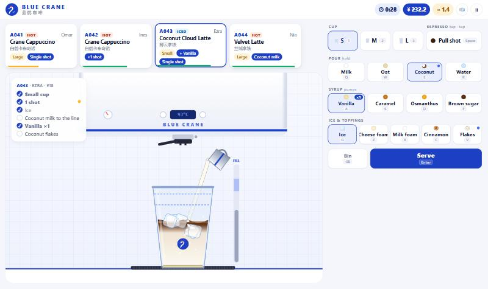
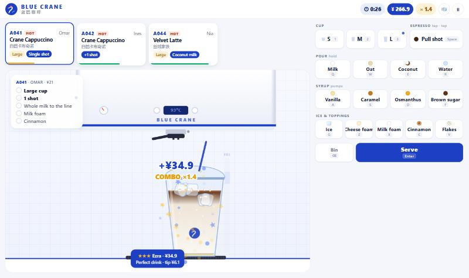
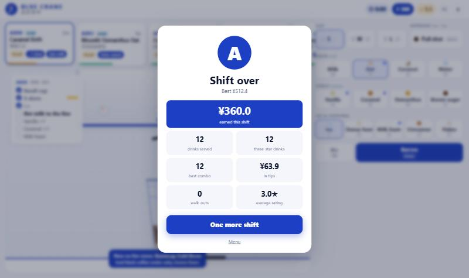
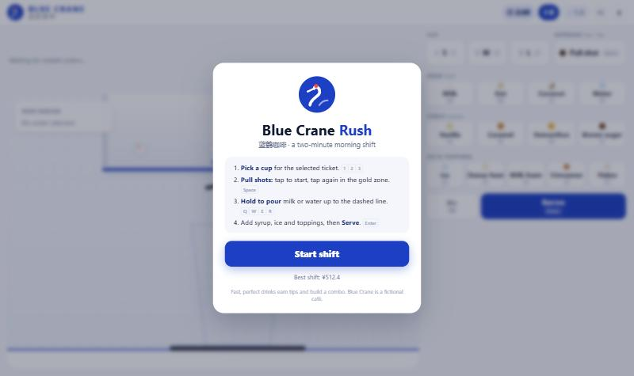
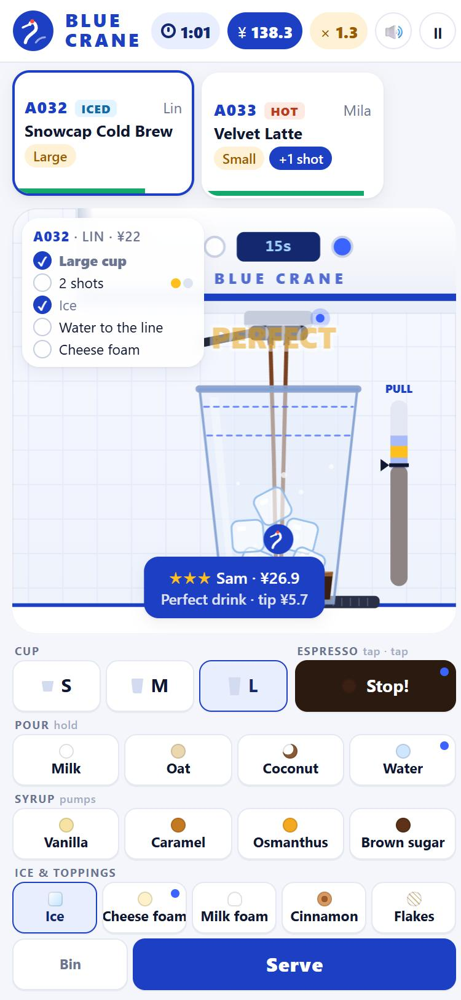

# Blue Crane Rush

[](https://github.com/wallaceandrew9331-create/blue-crane-rush/actions/workflows/ci.yml)

**[▶ Play it in your browser](https://wallaceandrew9331-create.github.io/blue-crane-rush/)**

A two-minute café rush game for the browser. Mobile orders pile up on the ticket rail at **Blue Crane Coffee (蓝鹤咖啡)**, and you have one shift to pull shots, pour milk, pump syrups and get every cup out before the customer gives up. Perfect drinks served fast earn tips and build a combo. Then it's "one more shift".

It plays on desktop (keyboard or mouse) and on phones (touch), with no install, no assets to download and no server.



| | |
|---|---|
|  |  |
|  | |



## How to play

Each ticket shows the drink, Hot or Iced, the size if it isn't a medium, and any customisations in blue. The selected ticket's recipe is pinned on the station as a checklist, and blue dots on the buttons show what it still needs.

| Step | Keyboard | Touch / mouse |
|---|---|---|
| Pick a cup | `1` `2` `3` (S/M/L) | S · M · L |
| Pull a shot: start, then stop the needle in the gold zone | `Space`, `Space` | Pull shot, Stop! |
| Hold to pour up to the dashed fill line | hold `Q` milk · `W` oat · `E` coconut · `R` water | hold the button |
| Syrup pumps | `A` vanilla · `S` caramel · `D` osmanthus · `F` brown sugar | tap |
| Ice and toppings | `G` ice · `Z` cheese foam · `X` milk foam · `C` cinnamon · `V` coconut flakes | tap |
| Serve to the selected ticket | `Enter` | Serve |
| Bin the cup | `Backspace` | Bin |
| Switch ticket | `Tab` / `←` `→` | tap a ticket |
| Pause, mute | `Esc`, `M` | ⏸, 🔊 |

**Scoring.** Every drink is judged on two things:

- **Accuracy**: right size, shot count, milk, hot or iced, syrup pumps and toppings. Each part is weighted, with partial credit for near misses (one shot off costs half the shot credit).
- **Craft**: how well each shot was timed (perfect, good, sour or bitter) and how close the cup is to the fill line. Overflowing it is a disaster.

Together they give 0 to 3 stars. Three stars extends your combo (+5% per step, up to ×1.5), two holds it, one breaks it, and anything below 70% accuracy gets sent back for a remake. Pay is the price scaled by accuracy, plus a tip that shrinks as the customer waits and as craft slips. Customers whose patience bar runs out walk out.

**The ramp.** The shift opens with three simple drinks, medium cups and one ticket at a time. Over two minutes the menu grows to nine drinks, sizes and customisations appear ("oat milk", "+1 shot", "no syrup", "+ cheese foam"), tickets arrive faster (every 10 s down to every 4.5 s) and patience shrinks. The shift ends with a grade from S to D.

## The menu

| Drink | 中文 | Build |
|---|---|---|
| Blue Hour Americano | 蓝调美式 | 2 shots, ice, water |
| Velvet Latte | 丝绒拿铁 | 2 shots, steamed whole milk |
| Coconut Cloud Latte | 椰云拿铁 | 2 shots, ice, coconut milk, coconut flakes |
| Moonlit Osmanthus Oat | 月桂燕麦拿铁 | 2 shots, oat milk, 1 osmanthus |
| Snowcap Cold Brew | 雪顶冷萃 | 2 shots, ice, water, cheese foam |
| Ember Brown Sugar Oat | 炙烤黑糖燕麦 | 2 shots, ice, oat milk, 2 brown sugar |
| Crane Cappuccino | 白鹤卡布奇诺 | 2 shots, whole milk, milk foam, cinnamon |
| Caramel Drift | 焦糖云朵 | 2 shots, ice, whole milk, vanilla, caramel, milk foam |
| Silk Ristretto | 丝滑澳白 | 3 shots, whole milk |

## Running it

Needs Node 22+.

```bash
npm install
```

```bash
npm run dev
```

That serves the game at http://localhost:5190 (also on your LAN IP, so you can try it on a phone).

```bash
npm test
```

That runs the 30 Vitest tests for order generation, drink judging, payouts and shift pacing.

```bash
npm run lint && npm run typecheck && npm run build
```

```bash
npm run sim
```

That plays 200 shifts each with four simulated baristas and prints how they score (the tuning tool, see below).

## How it's built

```
src/game/    the rules: pure TypeScript, no DOM, no clock, seeded randomness
  menu.ts      ingredients, recipes, prices
  orders.ts    seeded order generation, customisations, difficulty knobs
  build.ts     the drink on the counter and the actions that change it
  meters.ts    the espresso pull meter and the accelerating pour
  judge.ts     accuracy + craft → stars and a list of mistakes
  scoring.ts   price, speed tip and combo multiplier
  shift.ts     the two-minute shift: spawning, patience, walk-outs, grade
src/ui/      the presentation
  stage.ts     Canvas 2D station: machine, cup layers, ice, foam, streams, particles
  hud.ts       DOM ticket rail, recipe checklist, button hints, overlays
  audio.ts     WebAudio synthesis
src/main.ts  input, game loop and screens
tools/sim.ts simulated-barista balance sweep
```

**Rules are pure.** Everything under `src/game` is plain functions and one small class with no DOM access, no `Date` and no `Math.random` (an ESLint rule enforces this). Orders come from a seeded mulberry32 generator, so tests can say things like "a flawless barista on seed 123 never loses a customer and grades S", and the balance simulator can replay hundreds of shifts in a second.

**Two scores, not one.** With a single percentage, a perfectly timed drink with the wrong milk would feel the same as a correct drink with burnt shots. Splitting *accuracy* (did the right things go in?) from *craft* (were they made well?) made the feedback readable ("Oat milk, wanted coconut milk · Sour shot") and let stars mean something: three stars needs both.

**The UI is DOM plus one canvas.** Tickets, the checklist and buttons are ordinary DOM, which gives crisp text, accessibility and an app-like feel for free. The station is a Canvas 2D scene drawn in vector shapes each frame: layered liquids clipped to the cup, iced lattes that separate into milk and espresso, brown-sugar stripes up the cup wall, ice that drops in and bounces, foam that domes over the rim, steam, splashes, lids and straws on serve. Every sound is synthesised with WebAudio (filtered noise for pours and steam, blips for UI), so the whole game is about 20 KB of gzipped JavaScript.

**Touch first.** Buttons act on `pointerdown` (no 300 ms click delay), pours use pointer capture so a thumb that slides off still stops pouring, and the layout fits a 360×640 phone without scrolling. On desktop the controls move into a side column and every button shows its key.

### Tuning

`tools/sim.ts` models four baristas by speed per step, time per shot, how often they slip, and how far off they stop the meters. It plays each through 200 shifts. The first version of the pacing was far too generous (every skilled barista got an S and nobody ever lost a customer), and a browser playtest turned up one rule that was too lenient:

| Problem found | Change |
|---|---|
| Even a slow first-timer mostly earned an A. | Grades rescaled to S ≥ ¥420, A ≥ 290, B ≥ 180, C ≥ 90. |
| A long combo doubled pay, so the score was mostly combo. | Combo step 10% → 5% per drink, capped at ×1.5. |
| The queue never got stressful. | Tickets every 10 s → 4.5 s (was 13 → 6.5), up to 5 at once late in the shift, patience 50 → 30 s plus a bonus for fiddly drinks. |
| In a playtest, a latte with the wrong milk *and* the wrong temperature still paid a star. | Acceptance threshold 60% → 70% accuracy. |

Current sweep: first-timer mostly C (some B), casual A/B, good mostly S, expert always S. The bots never spend time reading tickets, so real players should expect to land about a grade lower.

## Deploying

It's a static site: `npm run build` writes `dist/`, and Vite's `base: './'` lets it work from any path. [`.github/workflows/pages.yml`](.github/workflows/pages.yml) deploys to GitHub Pages on a manual trigger; the live build is at https://wallaceandrew9331-create.github.io/blue-crane-rush/ (enable Pages with source "GitHub Actions" first). For Cloudflare Pages or Netlify, use build command `npm ci && npm run build` and output directory `dist`.

## Credits

An original game by Andrew Wallace. The look is inspired by the clean blue-and-white style of modern Chinese coffee chains, but Blue Crane Coffee, its crane logo and every drink on the menu are fictional and made up for this game; it isn't affiliated with any real brand. MIT licensed.
